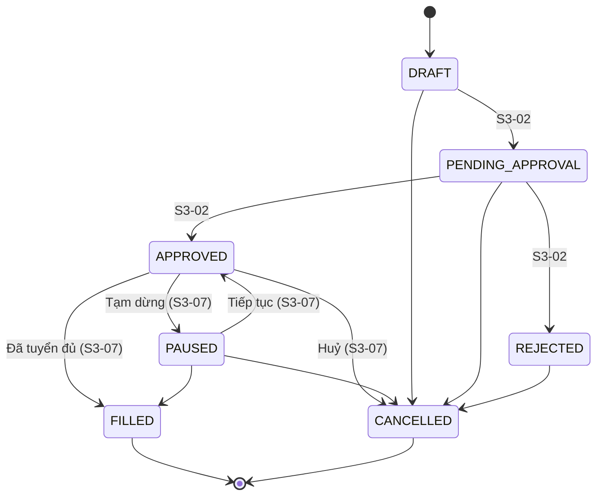

# S3-07 — Tạm dừng, đóng hoặc huỷ yêu cầu tuyển dụng

Vai trò: Trưởng phòng Nhân sự · Ưu tiên: Must · 5 SP · Epic EP-03

## 1. Vòng đời trạng thái (state machine)



Bảng chuyển nằm ở **một nơi duy nhất**: `src/domain/stateMachine.ts`. UI cũng dùng chính bảng này để quyết định hiện nút nào.

## 2. Luồng xử lý `changeStatus` (một giao dịch)

1. Kiểm quyền ở server (`HR_MANAGER`), sai → 403.
2. Đọc yêu cầu; kiểm tra chuyển trạng thái hợp lệ → sai 409 `INVALID_TRANSITION`.
3. Kiểm lý do theo trạng thái đích (bộ lý do riêng, "Lý do khác" bắt buộc ghi chú) → 422.
4. Nếu đích là **Đã tuyển đủ/Huỷ**: đếm ứng viên đang ở NEW/SCREENING/INTERVIEW/OFFER. Còn ứng viên và chưa xác nhận → 409 `PIPELINE_WARNING` kèm số lượng theo giai đoạn.
5. Nếu đích **không phải APPROVED**: gỡ toàn bộ tin `PUBLISHED` của yêu cầu. Gỡ lỗi → rollback, 502 `UNPUBLISH_FAILED`.
6. Ghi trạng thái (khoá lạc quan `version`) + dòng nhật ký (người, vai trò, thời điểm, lý do, tin đã gỡ, số ứng viên đã xác nhận).
7. Commit. Bất kỳ lỗi nào ở bước 5–6 → hoàn tác toàn bộ.

## 3. API

| Method | Đường dẫn | Mô tả |
|---|---|---|
| POST | `/api/requisitions/:id/status` | Đổi trạng thái |
| GET | `/api/requisitions/:id/status-history` | Lịch sử chuyển trạng thái |

Body `POST`:
```json
{ "targetStatus": "FILLED", "reasonCode": "HEADCOUNT_REACHED", "note": "…", "acknowledgePipelineWarning": false }
```
`targetStatus`: `PAUSED` · `FILLED` · `CANCELLED` · `APPROVED` (chỉ để tiếp tục từ `PAUSED`).

| HTTP | `error.code` | Khi nào |
|---|---|---|
| 200 | — | Thành công, trả `requisition`, `history`, `unpublishedPostingIds` |
| 403 | `FORBIDDEN` | Không phải Trưởng phòng Nhân sự / chưa đăng nhập |
| 404 | `NOT_FOUND` | Không có yêu cầu |
| 409 | `INVALID_TRANSITION` | Chuyển trạng thái không hợp lệ |
| 409 | `PIPELINE_WARNING` | Còn ứng viên; `details = {total, byStage}`; gửi lại với `acknowledgePipelineWarning: true` |
| 409 | `CONCURRENT_MODIFICATION` | Người khác vừa sửa |
| 422 | `REASON_REQUIRED` / `INVALID_REASON` / `NOTE_REQUIRED` / `VALIDATION_ERROR` | Dữ liệu sai |
| 502 | `UNPUBLISH_FAILED` | Không gỡ được tin, đã hoàn tác |

Bộ lý do: xem `src/domain/reasons.ts`.

## 4. Truy vết yêu cầu → code → test

| Yêu cầu | Code | Test |
|---|---|---|
| AC1 Ba trạng thái + lý do | `reasons.ts`, `service.changeStatus` bước 3 | `acceptance.test.ts` (AC1), `stateMachine.test.ts` |
| AC2 Đóng/huỷ tự gỡ tin | `service.changeStatus` bước 5 | `acceptance.test.ts` (AC2), `service.test.ts` |
| AC3 Cảnh báo pipeline | `service.changeStatus` bước 4, `dialogModel.describePipelineWarning` | `acceptance.test.ts` (AC3), `controller.test.ts`, `dialogModel.test.ts` |
| AC4 Người thao tác + thời điểm | `StatusHistoryRepository`, `requisition_status_history` | `acceptance.test.ts` (AC4) |
| TN1 State machine | `stateMachine.ts` | `stateMachine.test.ts`, `acceptance.test.ts` (TN1) |
| TN2 Gỡ tin nhất quán | UnitOfWork + `reconcilePostings()` + trigger DB | `acceptance.test.ts` (TN2), `service.test.ts` (rollback, reconcile) |
| DoD quyền ở backend | `assertCanManage` | `service.test.ts`, `controller.test.ts` |
| DoD 360px | `RequisitionStatusDialog.css` (`@media max-width: 480px`, nút cao 44px) | `test/fe/responsive360.test.tsx` (`npm run test:360`, trình duyệt thật 360px) |
| DoD coverage ≥ 60% | cổng `--test-coverage-*=60` trong `npm test` | `npm test` |

## 5. Ánh xạ task Jira

| Task | Nội dung | File |
|---|---|---|
| SCRUM-134 [BE] Chuyển trạng thái kết thúc | state machine, lý do, ghi nhật ký | `domain/*`, `service/*` |
| SCRUM-135 [BE] Cảnh báo ứng viên còn trong pipeline | `PIPELINE_WARNING` | `service/*`, `ports.ts` |
| SCRUM-136 [BE] Tự động gỡ tin | gỡ tin trong giao dịch, `reconcilePostings`, trigger DB | `service/*`, `db/001_*.sql` |
| SCRUM-138 [TEST] Kiểm thử trạng thái và tích hợp tin | toàn bộ `test/*`, tích hợp HTTP thật | `test/*`, `test/server.integration.test.ts` |
| SCRUM-139 [FE] Hộp thoại tạm dừng, đóng, huỷ | dialog React + trang quản lý chạy được (`npm start`) | `frontend/*`, `server/*`, `test/e2e/*` |

## 6. Điểm cần PO xác nhận (giả định đã đặt)

1. **Tạm dừng cũng gỡ tin** (AC chỉ nêu đóng/huỷ). Lý do: tin đang treo mà yêu cầu đã dừng thì ứng viên vẫn nộp được. Khi **tiếp tục**, tin **không tự đăng lại** — recruiter đăng lại chủ động.
2. **Cảnh báo pipeline áp dụng cho Đã tuyển đủ và Huỷ**, không áp dụng cho Tạm dừng. "Còn trong pipeline" = ứng viên ở Hồ sơ mới/Sàng lọc/Phỏng vấn/Đề xuất offer; Nhận việc và Loại không tính.
3. Cảnh báo là **xác nhận để tiếp tục**, chưa tự chuyển/loại hàng loạt ứng viên.
4. Đã thêm thao tác **Tiếp tục** (Tạm dừng → Đã duyệt) vì Tạm dừng không có đường quay lại thì không dùng được.
5. Chỉ **Trưởng phòng Nhân sự** thao tác được (theo user story).

## 7. Gắn vào backend thật (NestJS hoặc Spring Boot)

Lõi nghiệp vụ không phụ thuộc framework. Chỉ cần: (a) viết adapter PostgreSQL cho các port trong `src/ports.ts` (UnitOfWork = transaction), (b) middleware JWT gắn `actor`, (c) route gọi `RequisitionStatusController`. NestJS:

```ts
@Post(':id/status')
async change(@Param('id') id: string, @Body() body: unknown, @Req() req, @Res() res) {
  const out = await this.controller.changeStatus({ actor: req.user, params: { id }, body });
  res.status(out.status).json(out.body);
}
```
Nếu chọn Spring Boot: port lại `service/requisitionLifecycleService.ts` (≈120 dòng) và giữ nguyên bảng test làm đặc tả.

Lên lịch `reconcilePostings()` chạy hằng đêm như lưới an toàn.
